# A simple MERN stack application 

### Create a network for the docker containers

`docker network create demo`

### Build the client 

```sh
cd mern/frontend
docker build -t mern-frontend .
```

### Run the client

`docker run --name=frontend --network=demo -d -p 5173:5173 mern-frontend`

### Verify the client is running

Open your browser and type `http://localhost:5173`

### Run the mongodb container

`docker run --network=demo --name mongodb -d -p 27017:27017 -v ~/opt/data:/data/db mongo:latest`

### Build the server

```sh
cd mern/backend
docker build -t mern-backend .
```

### Run the server

`docker run --name=backend --network=demo -d -p 5050:5050 mern-backend`

## Using Docker Compose

`docker compose up -d`

## Walkthrough

### 01. Preparing EC2: opening ports 5173, 5050 and 27017
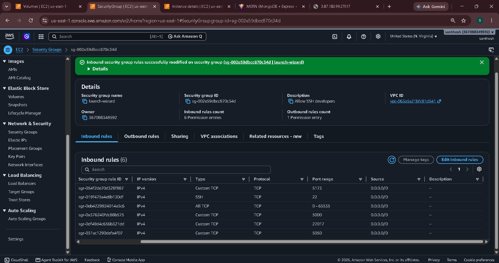
Wide-open rules were used for this lab only.

### 02. Frontend Dockerfile (initial version)
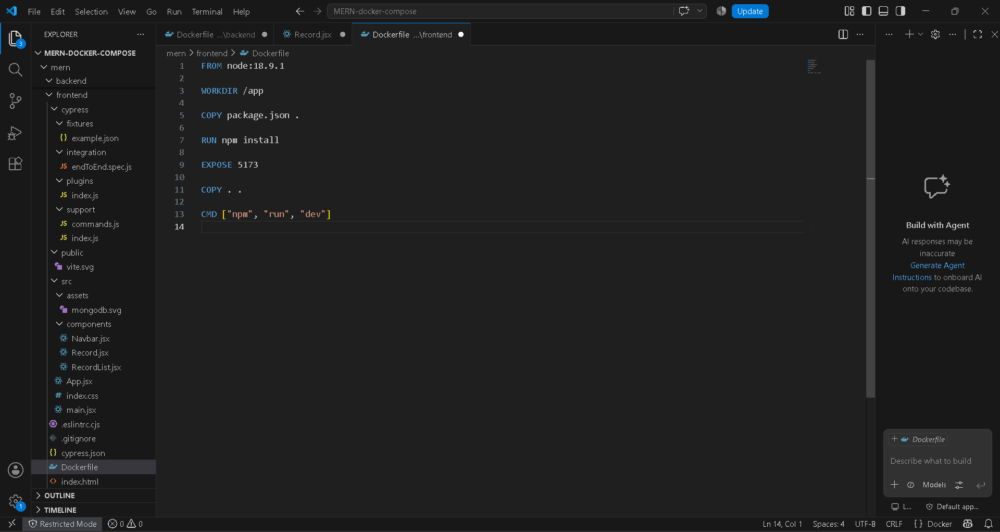
Later changed to `node:18-alpine`.

### 03. Frontend container running (no backend yet)
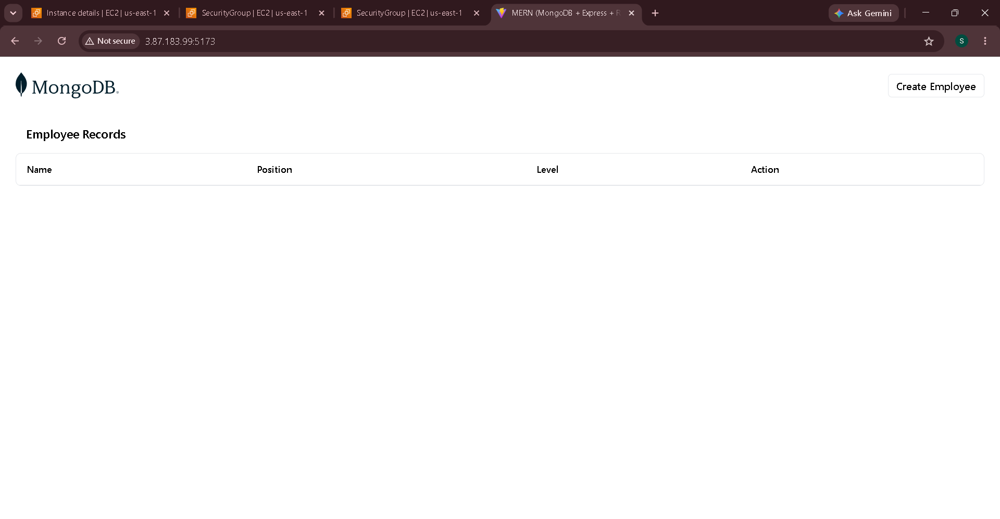

### 04. MongoDB fails: no space left on device
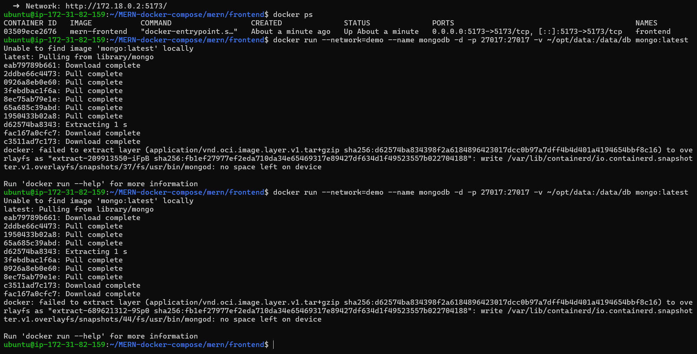

### 05. Creating a custom Docker network (`mern`)
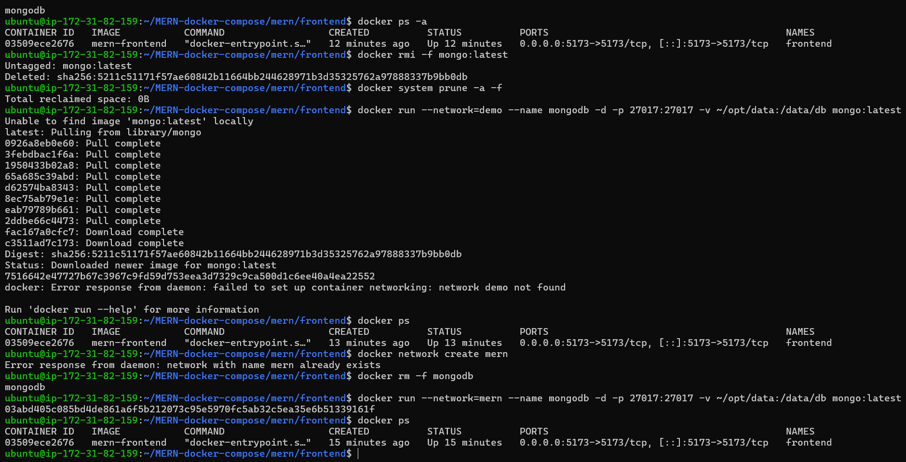

### 06. Fixing permissions for the MongoDB data volume
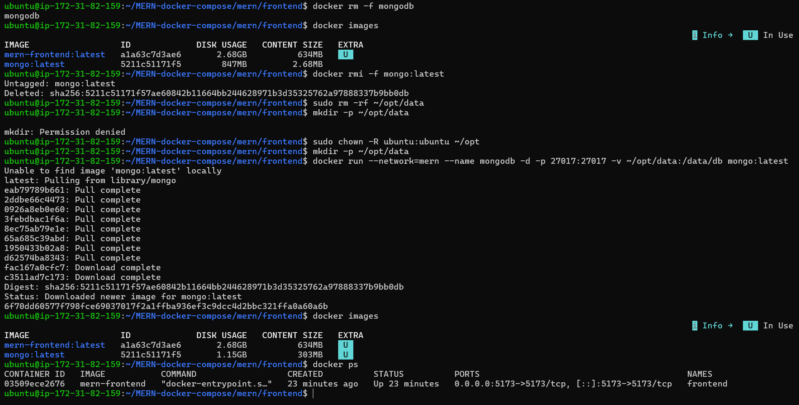

### 07. Root cause: `mongo:latest` incompatible with kernel 6.19+
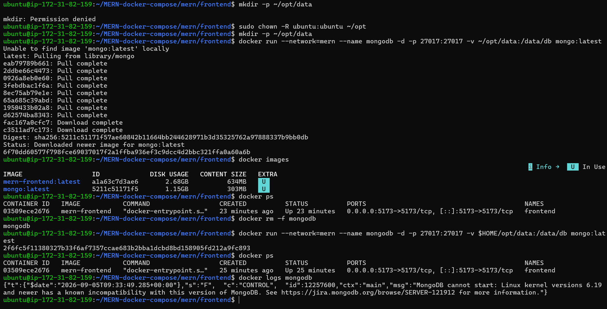

### 08. MongoDB running (pinned `mongo:7.0.12`)
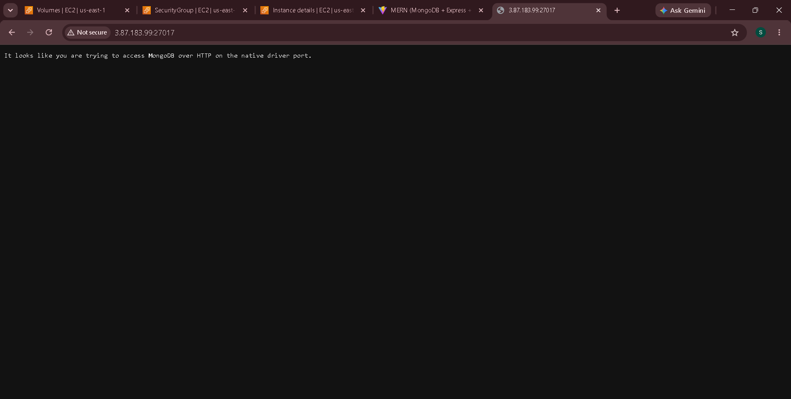

### 09. Backend API running on port 5050
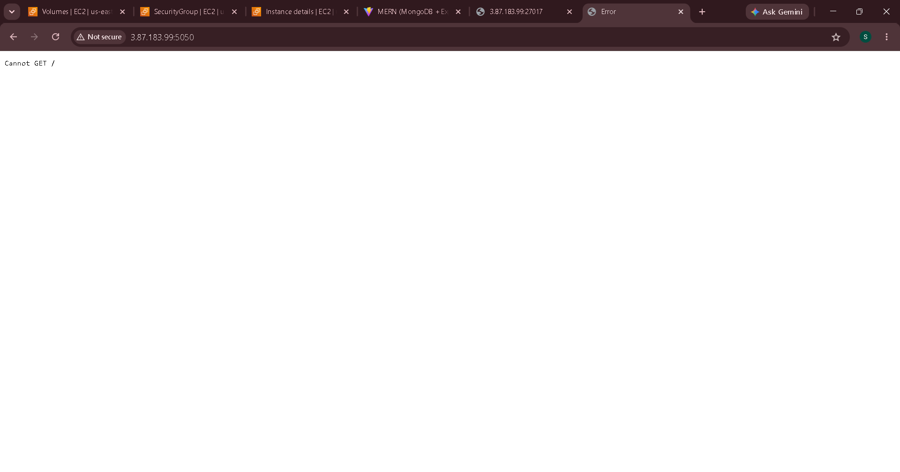
`Cannot GET /` is expected: the API only serves `/record`.

### 10. Frontend build fails: disk full
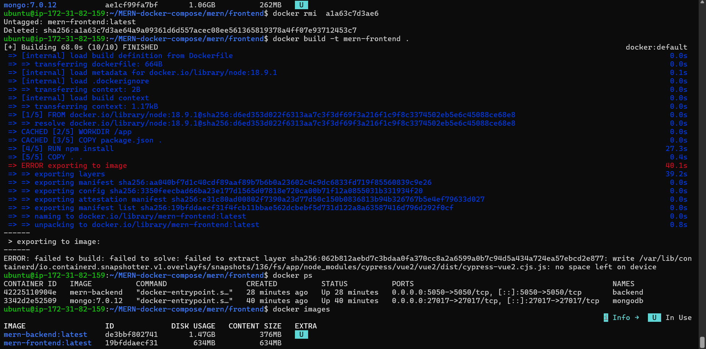

### 11. Still failing on `node:18-alpine`: Cypress download fills the disk
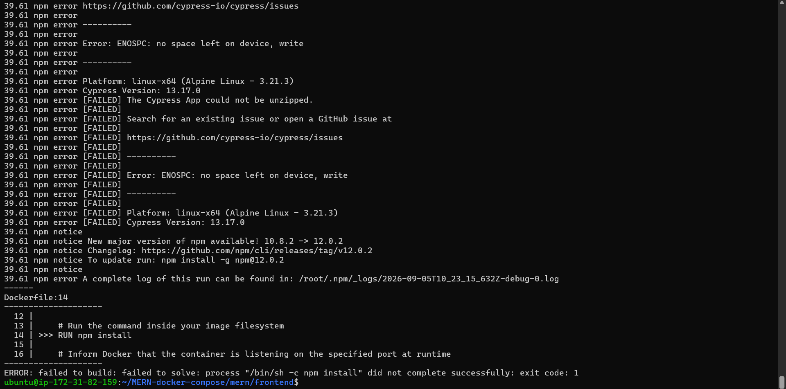

### 12. Frontend cannot reach the backend (DevTools)
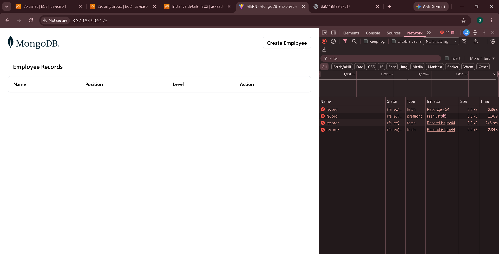

### 13. Cause: `localhost:5050` in `Record.jsx`
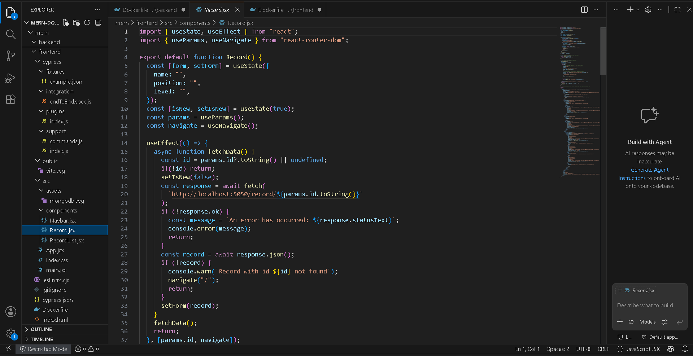
`localhost` points to my own machine, not the EC2 server. Fix: use the EC2 public IP.

### 14. Rebuild with `node:18-alpine`; backend connected to MongoDB
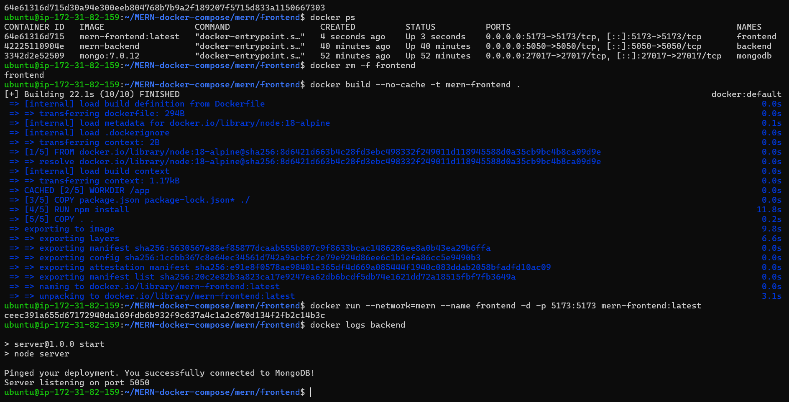

### 15. Final working MERN app on EC2
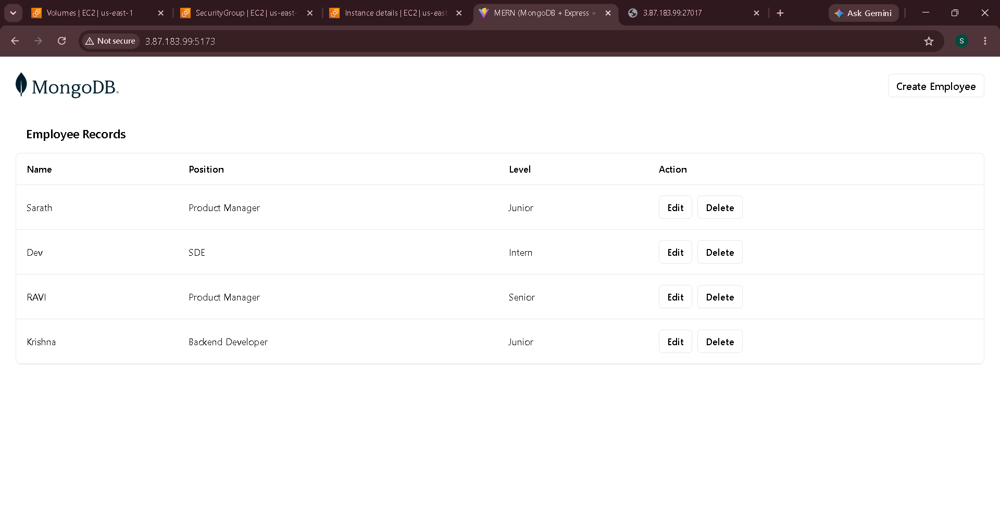

## Issues & fixes
| Problem | Cause | Fix |
|---|---|---|
| `no space left on device` | Small disk + large images (Cypress) | Pruned images, `node:18-alpine`, freed disk space |
| MongoDB exits immediately | `mongo:latest` incompatible with kernel 6.19+ | Pinned `mongo:7.0.12` |
| `mkdir: Permission denied` | `~/opt` owned by root | `sudo chown -R ubuntu:ubuntu ~/opt` |
| Empty table, failed fetches | `localhost:5050` hard-coded in `Record.jsx` | Use EC2 public IP, open port 5050 |
